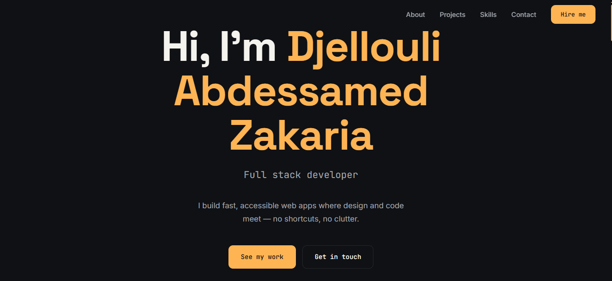

# Djellouli Abdessamed Zakaria — Portfolio

Personal portfolio website of **Djellouli Abdessamed Zakaria** (Zaki), a full stack developer focused on Laravel, React, and blockchain-based systems. The site showcases my background, selected projects, technical skills, and ways to get in touch.

🔗 **Live site:** _add your deployed URL here_

---

## Preview

### Hero



### About


### Projects


### Skills


### Contact


---

## Sections

1. **Hero:** name, rotating roles (Full stack developer, ERP Developer, Creative coder), and quick links.
2. **About:** short bio and key numbers (years of experience, projects built, happy clients).
3. **Projects:** selected work with descriptions, tech tags, and GitHub links.
4. **Skills:** grouped by Frontend, Backend, Tools, and Business Management.
5. **Contact:** contact form and social links (LinkedIn, WhatsApp, GitHub).

---

## Tech Stack

- **Framework:** React (with hooks: `useState`, `useEffect`, `useRef`, and a custom `useScrollReveal` hook)
- **Build tool:** Vite
- **Styling:** CSS variables for theming, inline styles, and responsive layouts using `clamp()` and CSS grid
- **Linting:** ESLint
- **Planned backend for the contact form:** Laravel REST API

---

## Project Structure

```
src/
├── components/     # One file per section (Navbar, Hero, About, Projects, Skills, Contact, Footer)
├── data/           # Content kept separate from UI: projects.js, skills.js
├── hooks/          # Reusable logic: useScrollReveal.js
├── styles/         # Global CSS variables, base styles, and reusable classes
└── App.jsx         # Assembles all sections in order
```

Content is edited in `src/data/` (projects and skills), so most updates do not require touching component code.

---

## Getting Started

### Prerequisites

- [Node.js](https://nodejs.org/) 18 or newer
- npm (comes with Node.js)

### Installation

```bash
# Clone the repository
git clone https://github.com/zakidjellouli47/<repository-name>.git
cd <repository-name>

# Install dependencies
npm install

# Start the development server
npm run dev
```

Open the local URL printed in the terminal (usually `http://localhost:5173`).

### Available Scripts

| Command | Description |
|---------|-------------|
| `npm run dev` | Start the development server with hot module replacement |
| `npm run build` | Create an optimized production build in `dist/` |
| `npm run preview` | Preview the production build locally |
| `npm run lint` | Run ESLint on the project |

---

## Customizing

- **Colors and fonts:** edit the CSS variables in `src/styles/global.css` (for example `--accent1` through `--accent5`).
- **Projects:** edit `src/data/projects.js`. Each project has a `title`, `description`, `tags`, `color`, `emoji`, and `repo` (GitHub link, optional).
- **Skills:** edit `src/data/skills.js`.
- **Social links:** update the `socials` array in `src/components/Contact.jsx`.

---

## Contact Form

The contact form collects a name, email, and message. The planned setup sends submissions to a Laravel backend, which emails them to me. Until that backend is connected, the form only shows a confirmation message on submit.

---

## Deployment

The project is a static Vite app, so it can be deployed to any static host:

```bash
npm run build
```

Upload the generated `dist/` folder to a host such as Vercel, Netlify, or GitHub Pages.

---

## Contact

- **LinkedIn:** [Djellouli Abdessamed Zakaria](https://www.linkedin.com/in/abdessamed-zakaria-djellouli-05a27b222/)
- **WhatsApp:** [+213 79 460 8293](https://wa.me/213794608293)
- **GitHub:** [zakidjellouli47](https://github.com/zakidjellouli47)

---

## License

This project is open for learning and reference. If you reuse the code or design, please credit the author. Add a license file if you want to set specific terms.

---

Built by **Djellouli Abdessamed Zakaria** · 2026
